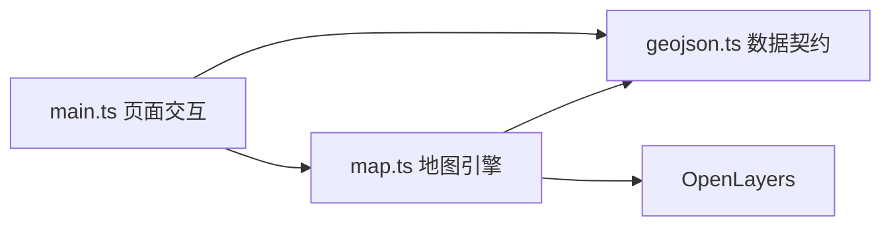

# 地图实验室架构

## 依赖方向

数据校验不依赖 DOM 或地图实例，适合纯单元测试；地图引擎封装图层和交互，页面层只绑定事件和反馈。要素名称通过 textContent 写入 DOM，不将导入数据作为 HTML 执行。

## 图层与投影

从下到上是本地示意矢量底图、默认隐藏的在线瓦片层、用户要素层。选择交互只作用于用户要素层，不会误选背景建筑。打开在线图层时才请求外部瓦片，OpenLayers 自动显示 attribution。

GeoJSON 在边界处通过 dataProjection=EPSG:4326 / featureProjection=EPSG:3857 显式转换。测量使用 ol/sphere 而不是直接把经纬度差当米数。

## 交互生命周期

工具切换时移除旧 Draw；Select 与 Modify 根据模式启停，避免多个绘制工具同时监听事件。新增要素分配 id 和名称。清空/导入会清除选中状态，导入先完成全部校验，再确认替换，避免失败留下半份数据。

修改产生 changefeature 事件，列表刷新合并到微任务中，避免同一操作的多次同步渲染。ResizeObserver 通知地图容器变化，CSS 负责断点布局。

## 数据边界

只接受三个明确的几何类型，检查坐标数值、经纬度范围、最少节点数和多边形闭合。id 与名称有长度约束；重复 id 拒绝；未知属性丢弃。导入不是通用 GIS 解析平台，不支持 GeometryCollection/Multi* 或复杂拓扑修复。

新增复杂功能时优先扩展数据契约和测试，再扩展地图交互，不将校验散落在按钮回调中。
